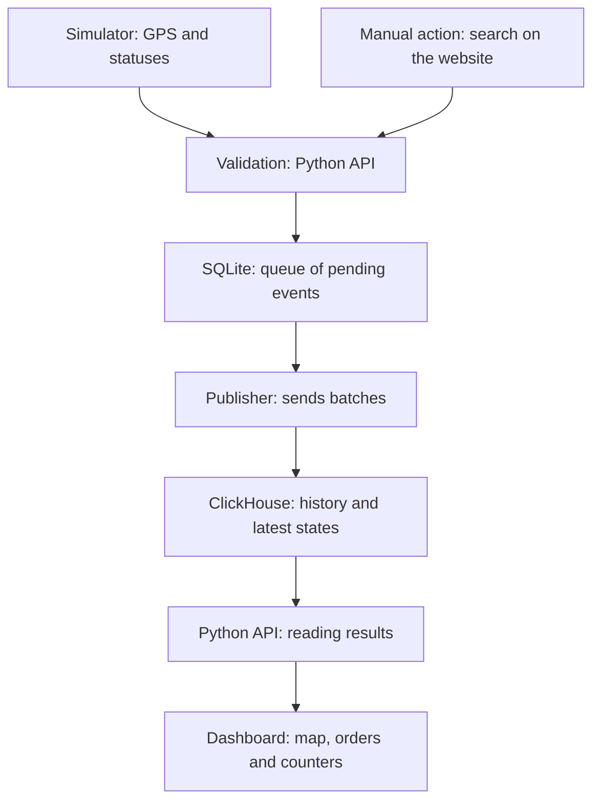
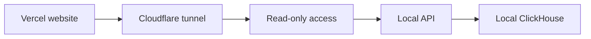

# Delivery Atlas: visual guide to understand it quickly

For Jere, Anuar and Echenique. Revision: 14 October 2026. Summary of the technical document; the counts and the publication cited were verified on 7 October. It does not check that the lab is running today.

## 1. What we are doing

We are building a fictional food-delivery platform: we store events in ClickHouse and show a dashboard with moving couriers, orders and counters.

**Public sources:** OTTO and REES46 provide hundreds of millions of historical events. Ele.me provides recommendation samples; Glovo, catalog products. They are used to study volume and queries. They share no users or IDs with each other.

**Our scenario:** Madrid, 12 simulated couriers by default, fictional orders and amounts, and generated or manual browsing actions. It is used to demonstrate our infrastructure working.

ClickHouse does not capture clicks on its own: our code creates or receives records and the database makes them queryable. Tracking is simulated, but the map reads positions that have gone through the queue and ClickHouse.

**We already have:** database, ingestion, simulation, dashboard and a shared website.
**Missing:** a commercial mini-app with checkout connected to an order, and a verified reproduction on another computer.

## 2. How everything connects



The arrows show the path of the data. The dashboard asks the API for results, and the API queries ClickHouse. Validation and reading belong to the same program; the built-in simulator uses its validation and queue directly.

- **API:** the entry point for writes and queries.
- **SQLite:** persistent waiting room.
- **Publisher:** sends several records together.
- **ClickHouse:** stores and computes what we query.
- **Dashboard:** displays those results.

Docker starts and connects the services. There is a single ClickHouse node; having an API and a queue does not add nodes to that database.

## 3. What we store and what we see

| Table | One row represents | On the dashboard |
|---|---|---|
| `app_events` | An action: search, open or add to cart | Browsing counts |
| `order_events` | A snapshot of an order in one status | Active, delivered, cancelled and fictional amount |
| `courier_positions` | A courier position, with ID and time | Marker and path of the order |

**Example of a new position:** the simulator moves a courier, validation accepts the record into the queue, the publisher inserts it and a later query updates the map.

Accepted into the queue does not mean visible yet. If the same event is resent with the same ID and content, the logical queries avoid counting it as another one. An old position that arrives late does not replace a position with a more recent time.

There are two logical databases on the same server: `delivery` for historical data and `delivery_atlas` for our platform. Simulated clicks and orders are independent scenarios: we do not compute a commercial conversion between them.

Generation is requested every 2 s; the dashboard queries after finishing its read and waiting 2 s. The delay can be longer. The map shows fictional coordinates, not streets or the GPS of real couriers.

## 4. How to get started together

**View:** open https://delivery-atlas-demo.vercel.app (read only). It depends on Jere's computer, Docker and the tunnel being up.

**Run locally:** get the code from the `codex/actualizacion-clickstream-eleme` branch while the PR is not merged. With Docker/Compose, from the project folder:

```bash
docker compose -f compose.yaml --profile atlas up -d --build --wait
```

Open http://127.0.0.1:8001/, start the simulation, choose a courier and watch the time and coordinates change. The small demo does not need to download the massive historical data.

**Anuar: where to start.** Understand which fields an action has and how it is sent. Read `atlas/contract.py` and the dashboard's manual button. Possible next contribution: the commercial mini-app.

**Echenique: where to start.** Follow which query feeds each metric and check the dashboard on his computer. Read `atlas/clickhouse.py` and `web/atlas-dashboard.js`.

**Jere + Rayo:** help with questions about the database, ingestion and simulation. These are onboarding paths; the final split will be agreed together.

### How a shared query arrives



ClickHouse and the simulator stay on Jere's computer. The start/stop controls are in the local demo.

**Full guide:** `docs/TEAM-TECHNICAL-GUIDE.md` and its 17-page PDF. Detailed installation: `docs/TRACKING-DEMO.md`. Sharing: `docs/SHARING-VERCEL.md`.
